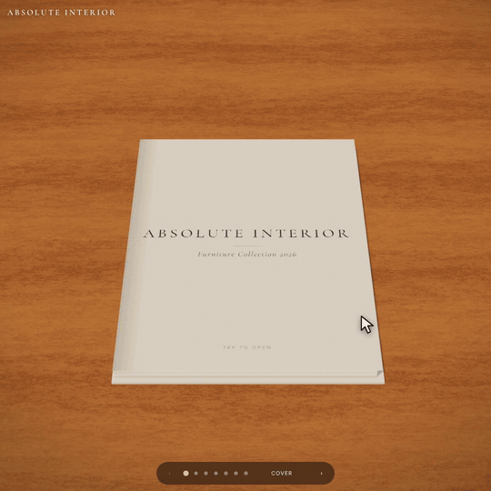
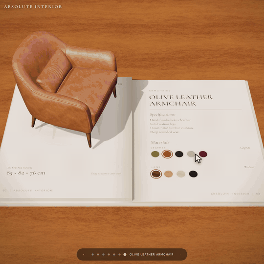
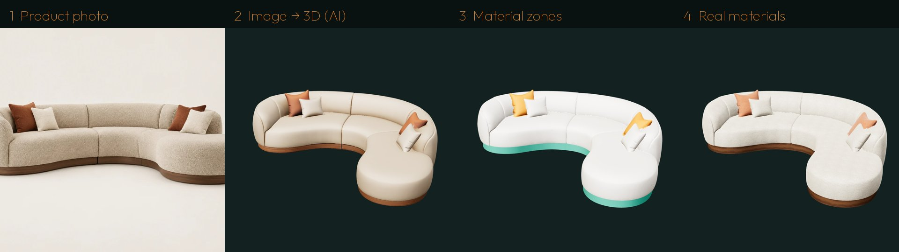

<div dir="rtl">

<p align="left"><a href="README.md">English</a> · <b>العربية</b></p>

# Absolute Interior: كتالوج موبيليا 3D

**تخيّل لو كل كتالوجات الموبيليا بقت كده.**

كتالوج تفاعلي على شكل كتاب مفتوح في المتصفح. تعمل سكرول فالصفحات تقلب، وكل قطعة موبيليا تطلع من الورق 3D. تسحبها فتلفّها في أي اتجاه، وتدوس على أي خامة فالقماش أو الجلد أو الخشب أو الحجر أو المعدن يتغيّر على القطعة نفسها في نفس اللحظة.

### ▶ الديمو: https://ahmakader.github.io/absolute-interior-3d-catalogue/

<p align="center"> </p>

بيشتغل على الكمبيوتر والموبايل من غير ما تنزّل أي حاجة. هو ملف HTML واحد ومعاه الموديلات والخامات.

---

## ⚠️ الموديلات الـ3D عليك

الريبو ده بيحوّل موديلات 3D لكتالوج تفاعلي، **بس مش بيعمل الموديلات من صورك لوحده**. لكل قطعة محتاج موديل 3D، وتجيبه بطريقة من دول:

- **تولّده من صورة المنتج** بأداة تحويل صورة لـ3D (القايمة تحت)، وبعدين تنضّفه بأدوات الريبو أو بسكيل Claude.
- **تنزّله** من موقع المصنّع أو من مكتبة موديلات مجانية.
- **تعمله** إنت أو مصمم 3D (Blender أو 3ds Max أو SketchUp…) وتعمله Export بصيغة `.glb`.

### أدوات تحويل صورة لـ3D

| الأداة | النوع | ملاحظات |
|---|---|---|
| [Hunyuan3D](https://3d.hunyuan.tencent.com) · [مفتوح المصدر](https://github.com/Tencent-Hunyuan/Hunyuan3D-2) | أونلاين، أو ببلاش على جهازك | اللي استخدمته في الديمو. تشغيله على جهازك محتاج كارت NVIDIA قوي |
| [TRELLIS](https://github.com/microsoft/TRELLIS) | ببلاش ومفتوح المصدر (مايكروسوفت) | جودة عالية، وفيه ديمو ببلاش على Hugging Face |
| [Stable Fast 3D](https://github.com/Stability-AI/stable-fast-3d) | ببلاش ومفتوح المصدر | سريع جدًا، والتفاصيل أبسط |
| [Meshy](https://www.meshy.ai) | أونلاين وفيه خطة ببلاش | سهل، وبيطلّع خامات PBR |
| [Tripo](https://www.tripo3d.ai) | أونلاين وفيه خطة ببلاش | سريع وبيطلّع موديل نضيف |
| [Rodin (Hyper3D)](https://hyper3d.ai) | أونلاين بكريدت مدفوع | تفاصيل عالية بجودة إنتاج |
| [Higgsfield](https://higgsfield.ai) | أونلاين بكريدت | فيه Hunyuan3D، وبيشتغل كمان كـconnector جوه Claude |

نصيحة: استخدم صورة واحدة نضيفة لكل قطعة، على خلفية سادة، ومتصوّرة من زاوية. صدّر الموديل بصيغة GLB، وتوقّع إنه يطلع تقيل ومش متظبط، ودي بالظبط وظيفة أدوات الريبو.

### موديلات موبيليا جاهزة وببلاش

| المكتبة | الرخصة | ملاحظات |
|---|---|---|
| [BIMobject](https://www.bimobject.com) | تحميل ببلاش (بشروط المصنّع) | موبيليا حقيقية من مصنّعين حقيقيين، وغالبًا أحسن اختيار لكتالوج براند حقيقي |
| [Poly Haven](https://polyhaven.com/models) | CC0، استخدمه في أي حاجة | مكتبة صغيرة بس جودتها عالية |
| [Sketchfab](https://sketchfab.com/search?features=downloadable&type=models&q=furniture) | بتختلف من موديل للتاني | اختار "Downloadable" وراجع رخصة كل موديل |
| [BlenderKit](https://www.blenderkit.com) | ببلاش + مدفوع | مكتبة موبيليا ضخمة جوه Blender |
| [3D Warehouse](https://3dwarehouse.sketchup.com) | بتختلف | موبيليا كتير، ومنها حاجات رافعها المصنّعين نفسهم |

**خامات ببلاش:** [Poly Haven](https://polyhaven.com/textures) و[ambientCG](https://ambientcg.com).

> راجع الرخصة دايمًا قبل ما تستخدم أي موديل أو صورة في كتالوج تجاري حقيقي.

## بيعمل إيه؟

- 📖 **كتاب 3D بجد:** الصفحات بتتني وتقلب مع السكرول. ممكن كمان تستخدم أسهم الكيبورد أو النقط، أو تدوس على طرف الصفحة. ولو دوست على أي سطر في صفحة الفهرس بيوديك للقطعة على طول.
- 🛋 **القطعة بتطلع من الصفحة:** أول ما الصفحتين يتفتحوا، الموديل بيطلع من الورق، وصورة المنتج المسطّحة تبهت تحتيه.
- 🔄 **لفّ حر:** اسحب القطعة ولفّها في كل الاتجاهات. دبل كليك يرجّعها لوضعها. وعلى الموبايل فيه زرار "Free rotate" يخلّي السحب يلفّ القطعة بدل ما يقلّب الكتاب.
- 🎨 **خامات لايف:** دوس على أي دايرة خامة في الصفحة اليمين، والجزء ده من القطعة يتغيّر في نفس اللحظة.
- ✨ **خامات PBR واقعية:** لمعان القماش، والكلير كوت للجلد والخشب، والمعدن المصقول.
- 📱 **جاهز للموبايل:** على الموبايل بتشوف صفحة واحدة، وزرار "Show materials" ينقلك بين القطعة والخامات.

## القطع والخامات

| القطعة | الأجزاء | الاختيارات |
|---|---|---|
| كنبة بوكليه منحنية | القماش · القاعدة · المخدات | 5 ألوان بوكليه · 4 أخشاب · 4 ألوان مخدات |
| كرسي تويد | التويد · الجوانب · القاعدة | 3 تويد · 4 جلد · نحاس / كروم / أسود / روز جولد |
| بوفيه خوص وجوز | الإطار · الخوص · المقابض | 4 أخشاب · خوص طبيعي / مدخّن · 4 معادن |
| ترابيزة ترافرتين | السطح · القاعدة | ترافرتين / رخام أبيض / رخام أسود · 4 أخشاب |
| كرسي جلد زيتي | الجلد · الرجول | 5 جلود · 4 أخشاب |

المجموع أكتر من 30 خامة.

## اتعمل إزاي؟ من صورة لكتاب 3D

<p align="center"></p>

1. **صورة المنتج:** البداية صور منتجات 2D عادية. الصور هنا اتعملت بالـAI.
2. **من صورة لموديل 3D بالـAI:** كل صورة بتتحوّل لموديل بموديل image-to-3D اسمه Hunyuan3D. الموديل بيطلع تقيل (حوالي 500 ألف مثلث و45 ميجا)، وكله قطعة واحدة بخامة واحدة متطبوعة عليه، فمينفعش تغيّر خاماته.
3. **أدوات التحويل بتشتغل** (مجلد `tools/`):
   - **تقسيم لخامات:** كل وش في الموديل بيتصنّف حسب لونه والتباين حواليه ومكانه. وحدود الخامات بتتقطع على منحنيات ناعمة، فالقماش والخشب والجلد يتقابلوا بشكل نضيف.
   - **تنضيف الموديل:** بيتصغّر لحوالي 90 ألف مثلث، والأجزاء البسيطة اللي الـAI بيطلّعها مش مستوية (زي قاعدة الكنبة وقاعدة الكرسي) بتتبني من جديد كأشكال نضيفة.
   - **تصغير الحجم:** بإحداثيات UV بالمتر وضغط meshopt، الموديل بينزل من حوالي 45 ميجا لـ**0.6 – 0.9 ميجا**.
4. **خامات حقيقية:** خامات PBR متولّدة بالكود: بوكليه، تويد، جلد، جوز، أوك، أش، أبنوس، خوص، ترافرتين، ورخام، وكلها بمقاسها الحقيقي.
5. **الكتاب:** كله بيتجمّع بـ[three.js](https://threejs.org) في كتاب 3D صفحاته بتتقلب.

## اعمل واحد زيه مع Claude

الملف [`skill/SKILL.md`](skill/SKILL.md) عبارة عن **سكيل لـClaude** بتعمل كل الخطوات دي بدالك:

1. ضيف السكيل لـClaude.
2. ارفع صور منتجاتك، صورة نضيفة لكل قطعة.
3. اطلب كتالوج 3D. Claude هيعمل الموديلات، ويقسّم الخامات، وينضّف ويصغّر الموديلات، ويحط الخامات، ويبني الكتاب، ويراجع كل قطعة وكل خامة.

> **محتاج أداة تحويل صورة لـ3D** للخطوة التانية، زي Higgsfield / Hunyuan3D أو Meshy أو Rodin أو Tripo، أو Hunyuan3D-2 / TRELLIS متسطّب عندك. الأداة دي مش موجودة في الريبو، ولو مفيش أداة متاحة السكيل بتقول لـClaude يقف ويقولك، بدل ما يألّف موديلات.

## تشغيله على جهازك

```bash
git clone https://github.com/ahmakader/absolute-interior-3d-catalogue
cd absolute-interior-3d-catalogue
python3 -m http.server 8000
```

وبعدين افتح http://localhost:8000. فتح `index.html` مباشرة من على الجهاز مش هيشتغل، لأن الموديلات بتتحمّل عن طريق HTTP.

## تستخدمه لكتالوجك

كل محتوى الكتالوج موجود في `PIECES` في أول الكود في `index.html`: اسم القطعة، والمقاسات، والموديل، والصورة، والأجزاء والخامات بتاعة كل جزء. اسم كل جزء لازم يكون نفس اسم الـmesh جوه ملف GLB. التفاصيل الكاملة في [النسخة الإنجليزي](README.md#use-it-for-your-own-catalogue).

## النشر على GitHub Pages

من الريبو: **Settings ← Pages ← Deploy from a branch ← `main` / `(root)`** واعمل حفظ. بعد دقيقة الموقع هيكون شغّال.

## الحقوق والأمانة

- **الكود:** رخصة MIT.
- **المحتوى:** تصميمات الموبيليا والصور والموديلات **معمولة بالـAI للديمو ده**، ومش منتجات حقيقية، و"Absolute Interior" براند وهمي. موديلات الـAI بتخمّن الجوانب اللي مش باينة في الصورة، والخامات متولّدة بالكود ومش مسح لقماش حقيقي.

</div>
