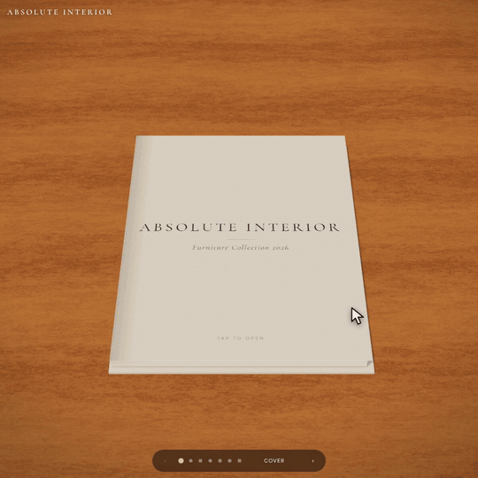
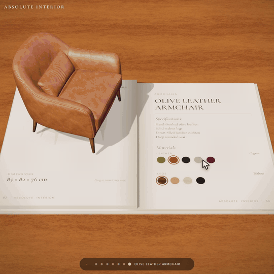
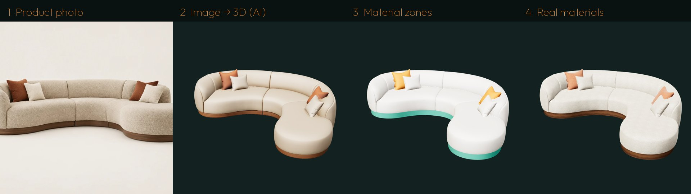

<p align="right"><b>English</b> · <a href="README.ar.md">العربية</a></p>

# Absolute Interior: a 3D furniture catalogue

**What if every furniture catalogue worked like this?**

An interactive catalogue built as an open book in the browser. Scroll and the pages turn, and each piece of furniture rises out of the paper in 3D. Drag it to turn it any way you like, and tap a swatch to change its fabric, leather, wood, stone or metal live, on the piece itself.

### ▶ Live demo: https://ahmakader.github.io/absolute-interior-3d-catalogue/

<p align="center"> </p>

It runs on desktop and phone with nothing to install. It's a single HTML file plus models and textures: no build step, no framework, no server code.

---

## Contents
- [You bring the 3D models](#️-you-bring-the-3d-models)
- [What it does](#what-it-does)
- [The pieces and finishes](#the-pieces-and-finishes)
- [How it was made, from photo to 3D book](#how-it-was-made-from-photo-to-3d-book)
- [Make your own with Claude](#make-your-own-with-claude)
- [Run it locally](#run-it-locally)
- [Use it for your own catalogue](#use-it-for-your-own-catalogue)
- [Publish it on GitHub Pages](#publish-it-on-github-pages)
- [Repository layout](#repository-layout)
- [Tech notes and lessons learned](#tech-notes-and-lessons-learned)
- [Credits, honesty and licence](#credits-honesty-and-licence)

---

## ⚠️ You bring the 3D models

This repo turns 3D models into an interactive catalogue. **It does not create the 3D models from your photos by itself.** For each piece you need a 3D model, either:

- **generated from your product photo** with an image-to-3D tool (see the list below), then cleaned up with this repo's pipeline or the Claude skill, or
- **downloaded** from the manufacturer or a free model library, or
- **modelled** by you or a 3D artist (Blender, 3ds Max, SketchUp…), exported as `.glb`.

### Image-to-3D tools (photo → 3D model)

| Tool | Type | Notes |
|---|---|---|
| [Hunyuan3D](https://3d.hunyuan.tencent.com) · [open source](https://github.com/Tencent-Hunyuan/Hunyuan3D-2) | Online + free to run locally | Used for this demo. Good shape and texture. Local runs need a strong NVIDIA GPU. |
| [TRELLIS](https://github.com/microsoft/TRELLIS) | Free, open source (Microsoft) | Strong quality. Runs locally, and there are free demos on Hugging Face Spaces. |
| [Stable Fast 3D](https://github.com/Stability-AI/stable-fast-3d) | Free, open source | Very fast. Simpler detail. |
| [Meshy](https://www.meshy.ai) | Online, free tier | Easy web app, with PBR texture options. |
| [Tripo](https://www.tripo3d.ai) | Online, free tier | Fast, with clean topology options. |
| [Rodin (Hyper3D)](https://hyper3d.ai) | Online, paid credits | High-detail, production-quality output. |
| [Higgsfield](https://higgsfield.ai) | Online, credits | Image-to-3D (Hunyuan3D) next to its image and video tools. Also works as a connector inside Claude. |

Tips: use one clean photo per piece on a plain background, at a three-quarter angle. Export as **GLB**. Expect the result to be heavy and noisy; that's what the pipeline cleans up.

### Free and ready-made 3D furniture

| Library | Licence | Notes |
|---|---|---|
| [BIMobject](https://www.bimobject.com) | Free download (manufacturer terms) | Real furniture from real manufacturers. Often the best option for an actual brand catalogue. |
| [Poly Haven – models](https://polyhaven.com/models) | CC0 (free for anything) | Small but high-quality set, including furniture. |
| [Sketchfab](https://sketchfab.com/search?features=downloadable&type=models&q=furniture) | Varies per model | Filter by "Downloadable" and check each licence (CC-BY needs credit). |
| [BlenderKit](https://www.blenderkit.com) | Free + paid | Huge furniture library inside Blender. |
| [3D Warehouse](https://3dwarehouse.sketchup.com) | Varies | Lots of furniture, including manufacturer uploads. Export to GLB through Blender or SketchUp. |

**Free materials and textures:** [Poly Haven textures](https://polyhaven.com/textures) and [ambientCG](https://ambientcg.com) (both CC0). Fabric, leather, wood and stone scans can replace the procedural sets in `tex/`.

> Always check the licence before using a model or image in a real commercial catalogue.

## What it does

| | |
|---|---|
| 📖 **A real 3D book** | The pages bend and curl as you scroll. You can also use the arrow keys, the page dots, or tap a page edge. Tapping an entry on the contents page jumps to it. |
| 🛋 **Pieces rise out of the page** | When a spread opens, its piece emerges from the paper, clipped by the page surface, and the flat product photo fades to a ghost underneath. |
| 🔄 **Free rotation** | Drag to turn a piece on every axis, with inertia. Double-click resets it. On phones, the "Free rotate" toggle switches the drag from scrolling the book to rotating the piece. |
| 🎨 **Live materials** | Tap a swatch on the right-hand page and that zone of the model changes instantly. Each piece has 2–3 zones, such as fabric / frame / base. |
| ✨ **PBR materials** | Every material uses albedo, normal and roughness maps on `MeshPhysicalMaterial`: sheen for fabrics, clearcoat for leather and wood, anisotropy for brushed metal. |
| 📱 **Phone-ready** | In portrait the book focuses on one page at a time, with a "Show materials" button to flip between the piece and its swatches. |

## The pieces and finishes

| Piece | Material zones | Options |
|---|---|---|
| Curved Boucle Sectional | Upholstery · Plinth · Pillows | 5 boucle colours · 4 woods · 4 pillow colours |
| Tweed Lounge Chair | Tweed · Side wings · Base | 3 tweeds · 4 leathers · brass / chrome / black / rose gold |
| Cane & Walnut Sideboard | Frame · Cane panels · Pulls | 4 woods · natural / smoked cane · 4 metals |
| Travertine Coffee Table | Top · Base | travertine / white marble / black marble · 4 woods |
| Olive Leather Armchair | Leather · Legs | 5 leathers · 4 woods |

That's 30+ finishes in total.

## How it was made, from photo to 3D book

<p align="center"></p>

1. **Product photo.** The catalogue starts as ordinary 2D product images. The ones here were generated with AI image models.
2. **Image → 3D with AI.** Each photo becomes a mesh through an image-to-3D model (Hunyuan3D). The raw result is heavy (about 500k triangles, ~45 MB) and is a single mesh with one baked texture, so you can't change its materials.
3. **The pipeline takes over** (`tools/`):
   - **Split into material zones.** Faces are classified from the baked texture by local contrast, chromaticity and height, then smoothed. The zone borders are cut exactly along smooth curves (`iso.py`), so fabric, wood and leather meet cleanly.
   - **Clean the mesh.** It's decimated to about 90k triangles. Simple parts that the AI makes lumpy, such as the sofa plinth and the chair's swivel base, are rebuilt as clean solids.
   - **Shrink it.** Box-projected UVs in real metres, quantisation and meshopt compression take each model from ~45 MB to **0.6–0.9 MB**.
4. **Real materials.** Procedural PBR texture sets (`tools/textures.py`) for boucle, tweed, leather, walnut, oak, ash, ebony, cane, travertine and marble. They tile at true real-world scale.
5. **The book.** Everything is assembled with [three.js](https://threejs.org) r160 into a page-curling 3D book.

## Make your own with Claude

[`skill/SKILL.md`](skill/SKILL.md) is a **Claude skill** that runs this whole pipeline for you:

1. Add the skill to Claude.
2. Upload your product photos, one clean image per piece.
3. Ask for a 3D catalogue. Claude generates the 3D models, splits the materials, cleans and shrinks the meshes, applies the materials, builds the book, and checks every piece and swatch.

> **You need an image-to-3D tool** ([list above](#image-to-3d-tools-photo--3d-model)) for step 2, such as a Higgsfield / Hunyuan3D connector, Meshy, Rodin, Tripo, or a local Hunyuan3D-2 / TRELLIS install. This repo doesn't include one. The skill tells Claude to stop and say so if none is available, rather than invent models.

## Run it locally

Any static file server works:

```bash
git clone https://github.com/ahmakader/absolute-interior-3d-catalogue
cd absolute-interior-3d-catalogue
python3 -m http.server 8000      # or: npx serve .
```

Then open http://localhost:8000. Opening `index.html` straight from disk won't work, because the models are fetched over HTTP.

## Use it for your own catalogue

All the catalogue content lives in the `PIECES` array near the top of the script in `index.html`:

```js
{ id:'sofa', no:42, cat:'Sofas', title:'Curved Boucle Sectional', dims:'310 × 150 × 72 cm',
  model:'models/sofa.glb', img:'img/sofa.webp',
  specs:['Oatmeal boucle fabric', '…'],
  zones:[
    { key:'fabric', label:'Upholstery', def:'oatmeal', opts:[ boucle('oatmeal','Oatmeal','#e2d8c6'), … ] },
    { key:'wood',   label:'Plinth',     def:'walnut',  opts:WOODS },
  ]}
```

- **`model`** is a GLB file. Each material zone must be its own mesh or material, named exactly like the zone `key`.
- **UVs** should be in metres, so that each texture option's `tile` value (also in metres) gives real-world scale.
- **`img`** is the flat product photo shown on the page before the model rises.
- **A material option** is `{id, name, set, tint, tile, rough, ns, sheen, clear, metal, an}`. `set` names a texture set in `tex/`: `<set>_albedo.webp`, `<set>_normal.jpg`, `<set>_rough.webp`. Leave out `set` for plain metals.

## Publish it on GitHub Pages

In the repo, go to **Settings → Pages → Build and deployment → Deploy from a branch → `main` / `/ (root)`** and save. After a minute the site is live at `https://<user>.github.io/<repo>/`. The included `.nojekyll` file makes Pages serve the files as-is.

## Repository layout

```
index.html        the whole app: three.js scene, book, interaction, catalogue data
models/           compressed GLB models, one mesh per material zone
tex/              PBR texture sets (albedo .webp, normal .jpg, roughness .webp)
img/              flat product images shown on the pages
skill/SKILL.md    the Claude skill: product photos in, 3D catalogue out
tools/            the asset pipeline (zones, clean borders, plinths, UVs, compression, textures)
assets/           README images
```

## Tech notes and lessons learned

- **Never store normal maps as lossy WebP.** Chroma subsampling corrupts them, and the furniture comes out speckled and fuzzy. Use JPEG with 4:4:4 chroma, or PNG.
- **Normalise normal-map strength** when generating, then tune intensity with `normalScale` in the page.
- **Image-to-3D meshes are noisy.** Smooth the shading, don't add bump detail, and rebuild simple primitives as clean solids.
- **Separate zones by local contrast and chromaticity**, not raw colour. Baked shadows fool colour distance.
- **Cut zone borders along an iso-line** of a smoothed per-vertex field, not along existing triangle edges. That is what makes them clean.
- See [`tools/README.md`](tools/README.md) for each script.

## Credits, honesty and licence

- **Code:** MIT, see [`LICENSE`](LICENSE).
- **Content:** the furniture designs, product images and 3D models are **AI-generated for this demo**. They don't depict real products, and "Absolute Interior" is a fictional brand. AI reconstructions guess the hidden sides of each piece, and the textures are procedural stand-ins for real fabric scans.
- **Built with:** [three.js](https://threejs.org), [glTF-Transform](https://gltf-transform.dev), [meshoptimizer](https://github.com/zeux/meshoptimizer), [trimesh](https://trimesh.org) and Hunyuan3D (image-to-3D).
