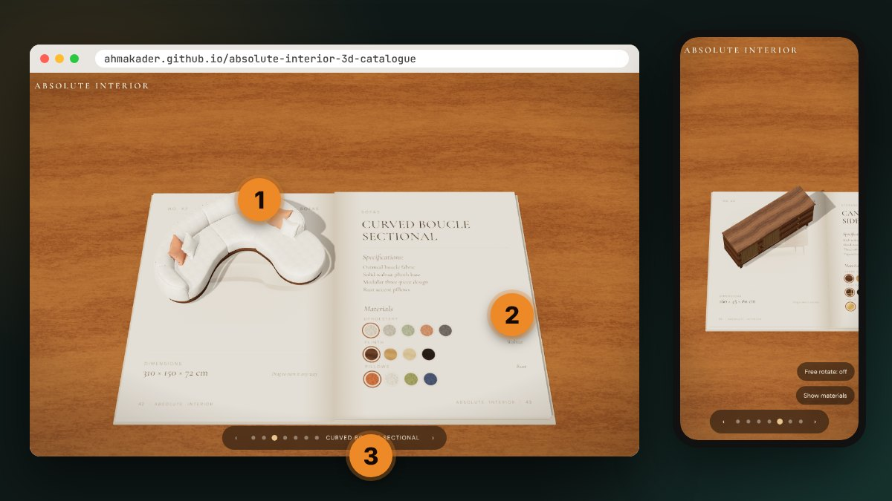
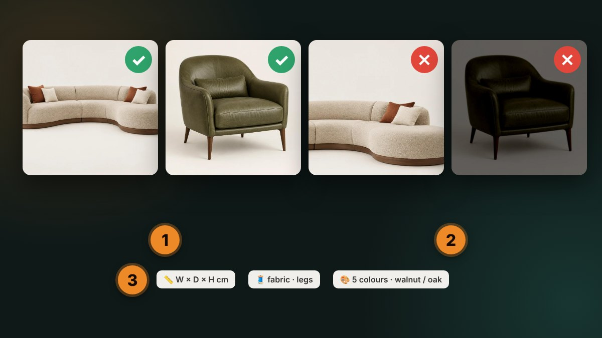
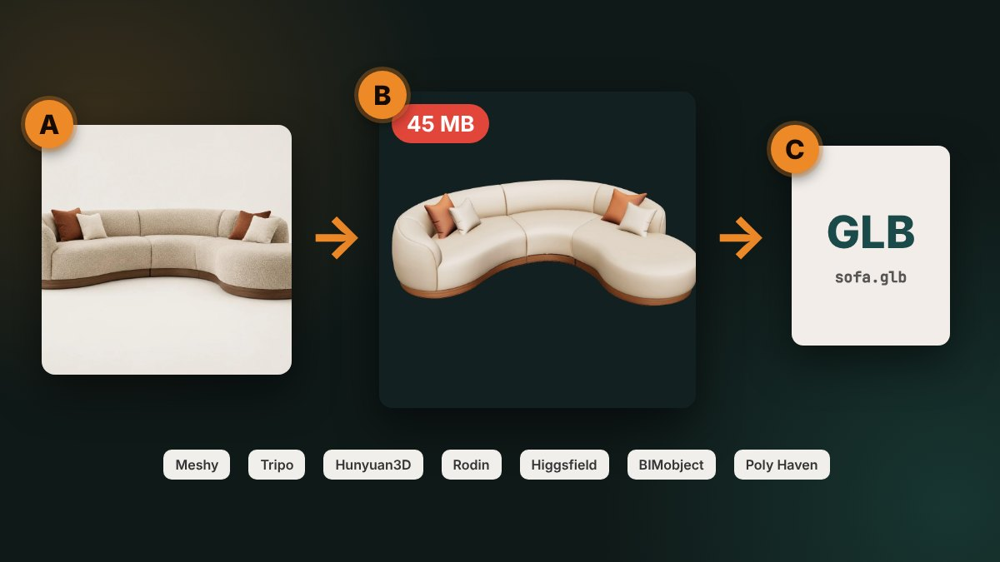
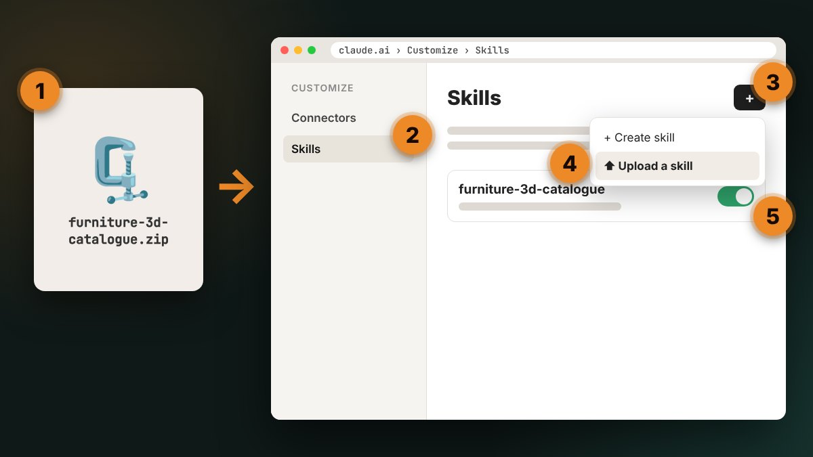
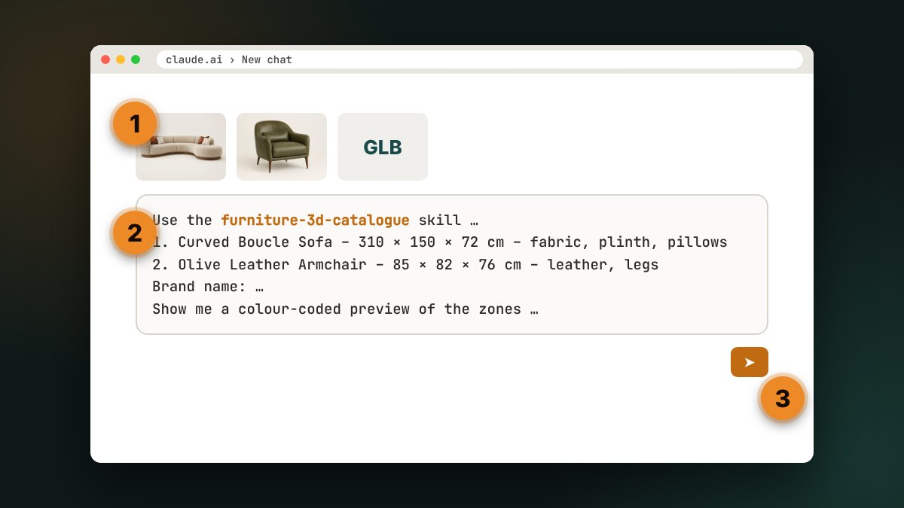
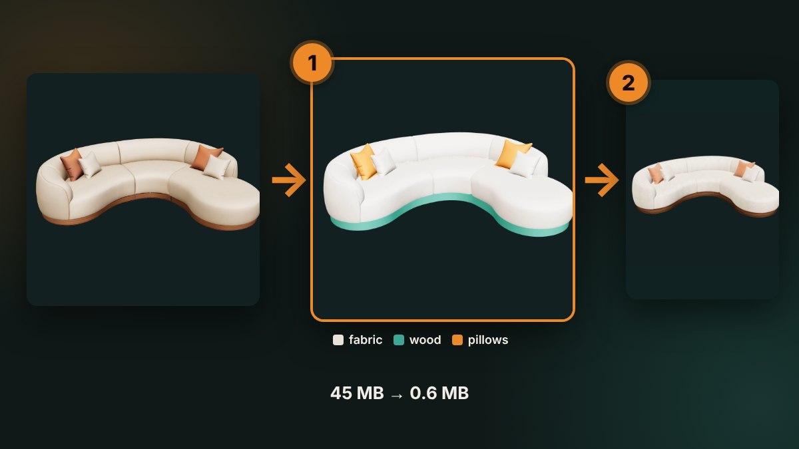
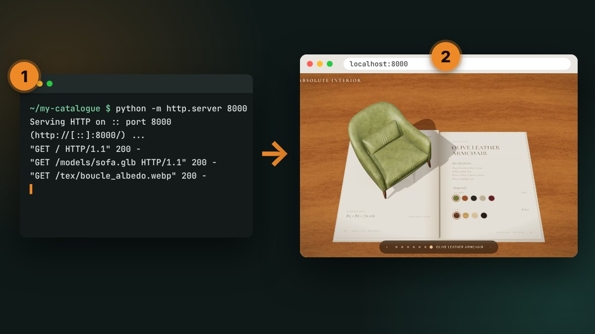
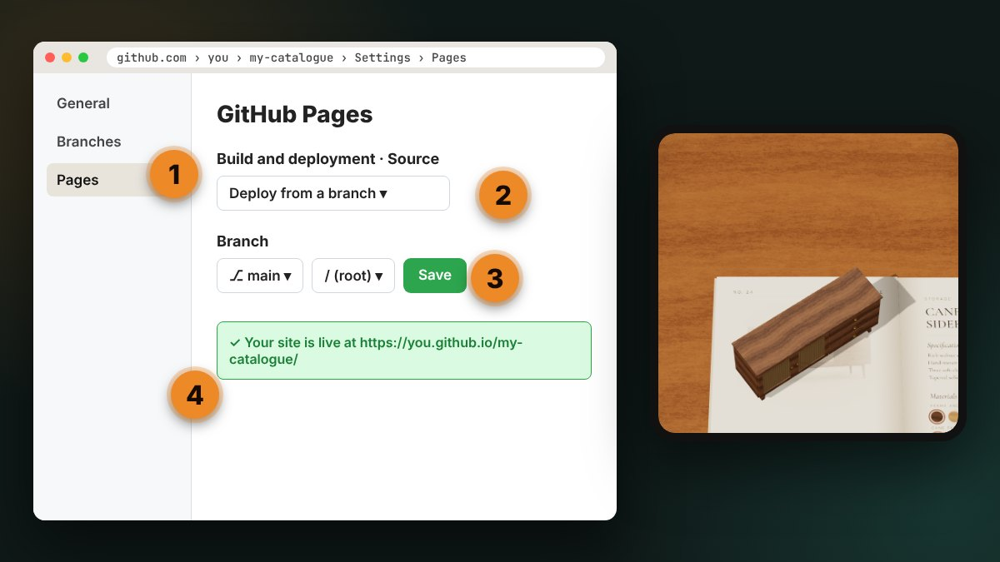

<div dir="rtl">

<p align="left"><a href="STEP_BY_STEP.md">English</a> · <b>العربية</b></p>

# خطوة بخطوة: اعمل كتالوج موبيليا 3D بتاعك مع Claude

من صور منتجاتك للينك كتالوج 3D تبعته لعملائك. مش محتاج تكتب كود. هياخد حوالي ساعة أو أقل لكام قطعة.

**النتيجة:** صفحة زي [الديمو](https://ahmakader.github.io/absolute-interior-3d-catalogue/) بالظبط. كتاب مفتوح، كل قطعة بتطلع من صفحتها، العميل يلفّها زي ما يحب، ويدوس على أي خامة فالقماش أو الجلد أو الخشب أو الحجر يتغيّر على القطعة نفسها.

---

## محتاج إيه؟

| | |
|---|---|
| ✅ **Claude** | أي خطة فيها Skills (Free أو Pro أو Max أو Team أو Enterprise)، مع تشغيل الـcode execution |
| ✅ **صور منتجاتك** | صورة واحدة نضيفة لكل قطعة |
| ✅ **موديل 3D لكل قطعة** | تعمله من الصورة بأداة تحويل لـ3D، أو تنزّله جاهز. شوف الخطوة 3. **الريبو ده لوحده مش بيحوّل الصور لـ3D.** |
| ⭕ **حساب GitHub** | اختياري وببلاش، لو عايز لينك عام لكتالوجك |

---

## الخطوة 1: شوف الديمو

<p align="center"></p>

**①** القطعة بتطلع من الصفحة · **②** دوس على أي خامة تتغيّر · **③** النقط والأسهم بتقلّب الصفحات. على اليمين: نفس الكتالوج على الموبايل.

افتح [الديمو](https://ahmakader.github.io/absolute-interior-3d-catalogue/) واعمل سكرول، لفّ القطع ودوس على الخامات. ده بالظبط اللي هتعمله.

## الخطوة 2: جهّز صورك

<p align="center"></p>

**①** صح: القطعة كلها باينة، خلفية سادة وفاتحة، ومتصوّرة من زاوية · **②** غلط: القطعة مقطوعة، أو الصورة ضلمة وفيها ضل تقيل · **③** لكل قطعة اكتب المقاس الحقيقي، والأجزاء اللي تتغيّر، والاختيارات.

- **صورة واحدة لكل قطعة**، والقطعة كلها باينة في الصورة.
- **خلفية سادة وفاتحة.** صورة استوديو أو صورة كتالوج تبقى ممتازة.
- **من زاوية** (الوش وجنب واحد باينين). الصورة اللي من قدام بالظبط بتطلّع موديل شكله مفلطح.
- من غير ناس، ولا قطع تانية داخلة في الصورة، ولا ضل تقيل.
- اكتب لكل قطعة:
  - **الاسم**، مثلاً "كنبة بوكليه منحنية"
  - **المقاس الحقيقي** بالسنتي: عرض × عمق × ارتفاع
  - **الأجزاء اللي العميل يقدر يغيّرها**، مثلاً *القماش · الرجول* أو *السطح · القاعدة*
  - **الاختيارات** لكل جزء، مثلاً *5 ألوان بوكليه · رجول جوز / أوك / أسود*

## الخطوة 3: هات موديل 3D لكل قطعة

<p align="center"></p>

**A** صورة المنتج ← **B** الموديل اللي بيطلع من أداة التحويل (تقيل، حوالي 45 ميجا، وكله خامة واحدة) ← **C** نزّله كملف `.glb`. تحت: أدوات ومكتبات تقدر تستخدمها.

اختار طريقة من دول:

**أ. خلّي Claude يعملها (الأسهل).** وصّل أداة تحويل صور لـ3D بـClaude، زي الـconnector بتاع **Higgsfield** (بيستخدم Hunyuan3D)، وClaude هيعمل الموديلات من صورك بنفسه. ده بيصرف من كريدت الخدمة دي.

**ب. اعملها إنت أونلاين وارفعها.** ارفع كل صورة على موقع من دول ونزّل النتيجة بصيغة **GLB**:
- [Meshy](https://www.meshy.ai) (فيه خطة ببلاش)
- [Tripo](https://www.tripo3d.ai) (فيه خطة ببلاش)
- [Hunyuan3D](https://3d.hunyuan.tencent.com)
- [Rodin](https://hyper3d.ai) (مدفوع، وأعلى تفاصيل)

سمّي كل ملف باسم القطعة، مثلاً `sofa.glb`.

**ج. نزّل موديلات جاهزة.** لو بتبيع موبيليا براند حقيقي، غالبًا المصنّع رافع موديلاته ببلاش على [BIMobject](https://www.bimobject.com). ولو عايز موديلات ببلاش فيه [Poly Haven](https://polyhaven.com/models)، أو [Sketchfab](https://sketchfab.com/search?features=downloadable&type=models&q=furniture) (راجع رخصة كل موديل).

> الموديلات اللي بتطلع من الطريقة (أ) أو (ب) بتبقى تقيلة ومش متظبطة وكلها خامة واحدة. ده طبيعي، ودي بالظبط وظيفة السكيل.

## الخطوة 4: ضيف السكيل لـClaude

<p align="center"></p>

**①** نزّل ملف الـZIP · **②** Customize ← Skills · **③** اضغط **+** · **④** Upload a skill · **⑤** اتأكد إنها متشغّلة. *رسم توضيحي: شاشات Claude ممكن تختلف شوية.*

1. نزّل **[`skill/furniture-3d-catalogue.zip`](../skill/furniture-3d-catalogue.zip)** من الريبو ده (افتح الملف واضغط **Download raw file**).
2. في Claude شغّل الـcode execution من: **Settings ← Capabilities ← "Code execution and file creation"** (في الشكل الجديد اسمها **"Create and edit files"**). لو حسابك Team أو Enterprise، الأدمن هو اللي يشغّلها.
3. روح **Customize ← Skills**، واضغط **+** وبعدين **Create skill+ ← Upload a skill**، واختار ملف الـZIP.
4. اتأكد إن **furniture-3d-catalogue** متشغّلة.

*بتستخدم Claude Code؟* انسخ فولدر `skill/furniture-3d-catalogue` لـ`~/.claude/skills/`.

أسماء القوايم ممكن تتغيّر. لو لقيتها مختلفة عندك، شوف شرح Anthropic: [Use Skills in Claude](https://support.claude.com/en/articles/12512180-use-skills).

## الخطوة 5: اطلب من Claude يبنيه

<p align="center"></p>

**①** ارفع صورك (وملفات الـGLB) · **②** الزق البرومبت واكتب بيانات قطعك · **③** ابعت.

افتح شات جديد، وارفع صورك (وملفات الـGLB لو اخترت الطريقة ب أو ج)، والزق ده:

```text
استخدم سكيل furniture-3d-catalogue واعملّي كتالوج 3D من المنتجات دي.

1. [الاسم] – [العرض × العمق × الارتفاع بالسنتي] – الأجزاء اللي تتغيّر: [مثلاً القماش (5 ألوان بوكليه)، الرجول (جوز، أوك، أسود)]
2. [الاسم] – [المقاس] – الأجزاء اللي تتغيّر: [...]
3. ...

اسم البراند على الغلاف: [اسم البراند]
الموديلات الـ3D: [اعملها من الصور بالأداة المتوصّلة / استخدم ملفات الـGLB اللي رفعتها]
ورّيني معاينة بالألوان لتقسيم الخامات لكل قطعة قبل ما تبني الكتاب.
```

## الخطوة 6: راجع التقسيم وسيب Claude يكمّل

<p align="center"></p>

**①** معاينة الألوان اللي Claude بيورّيهالك: كل لون خامة (قماش / خشب / مخدات). راجعها. · **②** القطعة النهائية بخامات حقيقية، واتصغّرت من 45 ميجا لـ0.6 ميجا.

Claude هيعمل كده:
1. يحوّل كل صورة لموديل 3D (في الطريقة أ)، أو ياخد ملفات الـGLB بتاعتك
2. **يقسّم كل موديل لخامات**، زي قماش / خشب / مخدات، ويورّيك معاينة بالألوان
3. ينضّف الموديل ويصغّره لأقل من 1 ميجا
4. يحط خامات حقيقية (قماش، جلد، خشب، حجر) بمقاسها الحقيقي
5. يبني الكتاب بقطعك، ويجرّب كل صفحة وكل خامة

👉 **لما تشوف معاينة الألوان، راجعها.** لو فيه جزء غلط قوله بكلامك العادي، مثلاً *"المخدات لازم تبقى جزء لوحدها"* أو *"الرجول داخلة في الإطار"*، وClaude هيصلّحها قبل ما يكمّل.

في الآخر هيديك **ملف ZIP فيه فولدر الكتالوج**.

## الخطوة 7: افتحه على جهازك

<p align="center"></p>

**①** شغّل السيرفر جوه فولدر الكتالوج · **②** افتح `localhost:8000` في المتصفح.

فك الضغط. لو دوست دبل كليك على `index.html` **مش هيشتغل**، لأن المتصفح بيمنع تحميل ملفات الـ3D من على الجهاز مباشرة. اعمل كده بدالها:

- **لو عندك Python:** افتح terminal جوه الفولدر واكتب `python -m http.server 8000`، وبعدين افتح http://localhost:8000
- **أو بـNode:** `npx serve .`
- **أو VS Code:** نزّل إضافة "Live Server" واضغط **Go Live**.

## الخطوة 8: انشره وابعت اللينك (ببلاش)

<p align="center"></p>

**①** Settings ← Pages · **②** Deploy from a branch · **③** `main` و`/ (root)` وبعدين **Save** · **④** بعد دقيقة أو اتنين اللينك هيظهر، وبيشتغل على الموبايل كمان. *رسم توضيحي: صفحة GitHub ممكن تختلف شوية.*

1. اعمل حساب ببلاش على [github.com](https://github.com) واضغط **New repository**. اديله اسم، وخليه **Public**، واعمله.
2. في صفحة الريبو الفاضية اضغط **uploading an existing file** (أو **Add file ← Upload files**). اسحب **كل اللي جوه** فولدر الكتالوج (`index.html` و`models` و`tex` و`img`…) واضغط **Commit changes**.
3. روح **Settings ← Pages**. تحت *Build and deployment* اختار **Deploy from a branch ← main ← / (root)** واضغط **Save**.
4. استنى دقيقة أو اتنين واعمل refresh. اللينك هيظهر فوق: `https://<اسم-حسابك>.github.io/<اسم-الريبو>/`

ابعت اللينك ده لعملائك، وبيشتغل على الموبايل كمان.

---

## لو حاجة مش شغالة

| المشكلة | الحل |
|---|---|
| الصفحة فاضية أو فاضلة تحمّل | إنت فاتح `index.html` مباشرة. شغّله بسيرفر محلي (الخطوة 7) أو من لينك GitHub Pages. |
| خامة شكلها منقّط أو مشوّش | الـnormal map متخزّنة WebP. قول لـClaude: *"احفظ كل الـnormal maps بصيغة JPEG 4:4:4"*. |
| الجزء الغلط هو اللي بيغيّر لونه | التقسيم متلخبط. اطلب من Claude يعيد تقسيم القطعة دي ويورّيك المعاينة بالألوان. |
| مقاس القطعة غلط | ادّي Claude المقاس الحقيقي تاني واطلب منه يظبطه. |
| ضهر القطعة شكله غريب | أدوات التحويل بتخمّن الجوانب اللي مش باينة. ضيف صورة من ورا، أو استخدم موديل المصنّع. |
| لينك GitHub بيطلّع 404 | استنى دقيقة أو اتنين، واتأكد إن `index.html` موجود على طول في الريبو، مش جوه فولدر. |
| Claude بيقول مفيش أداة 3D | استخدم الطريقة (ب) أو (ج) في الخطوة 3 وارفع ملفات الـGLB. |

## تعدّل فيه بعدين

- **تضيف قطعة:** ابعت لـClaude صورتها أو موديلها مع الـZIP الحالي وقوله *"ضيف دي للكتالوج"*.
- **تغيّر الألوان أو الاختيارات:** كله في قايمة `PIECES` في أول `index.html`، وClaude يقدر يعدّلها لك.
- **تستخدم خامات حقيقية:** ابعت صور أو سكان لأقمشة المصنّع، واطلب من Claude يعمل منها خامات.

---

عندك سؤال أو فكرة؟ افتح issue على الريبو ده.

</div>
