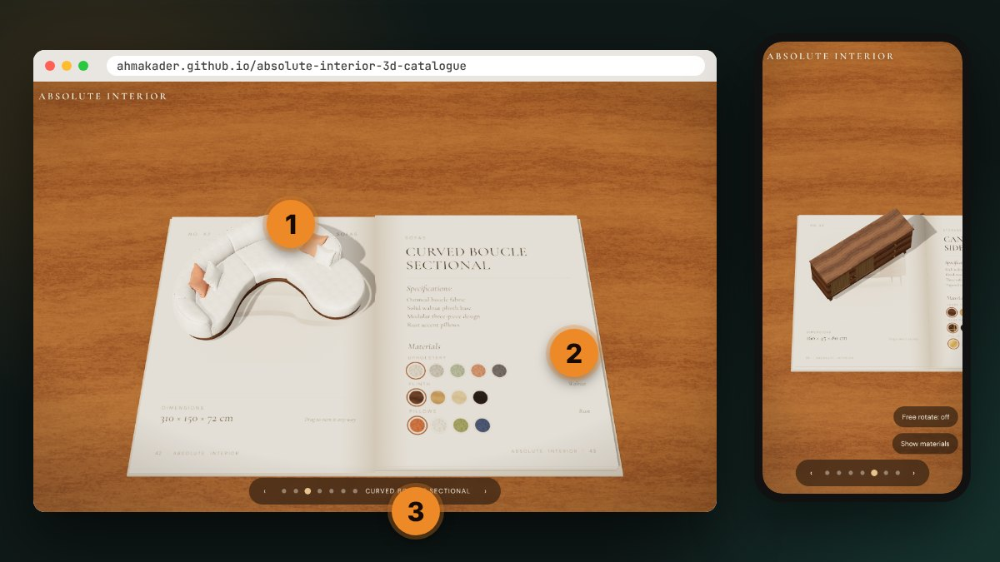
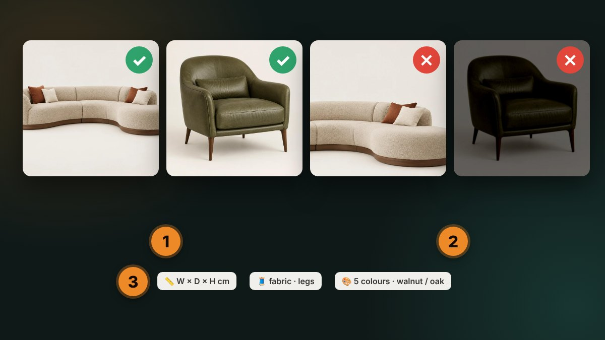
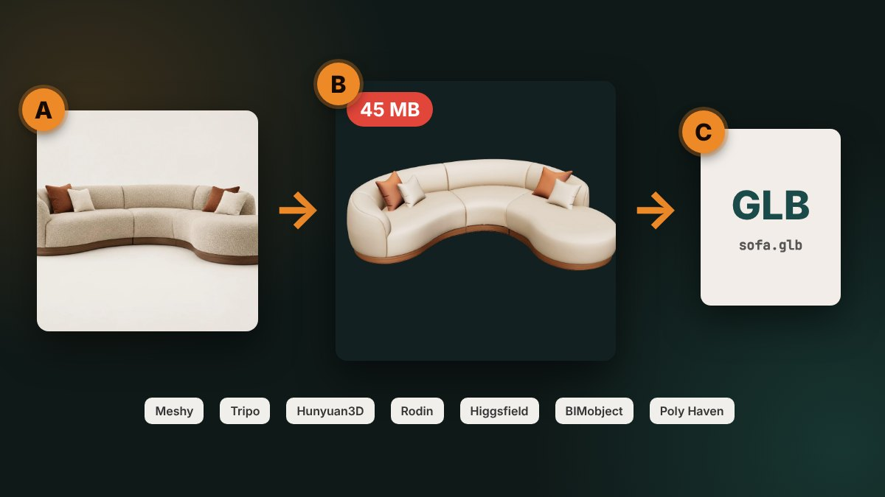
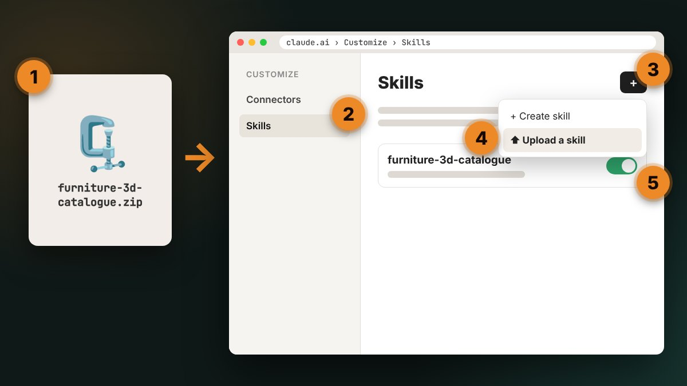
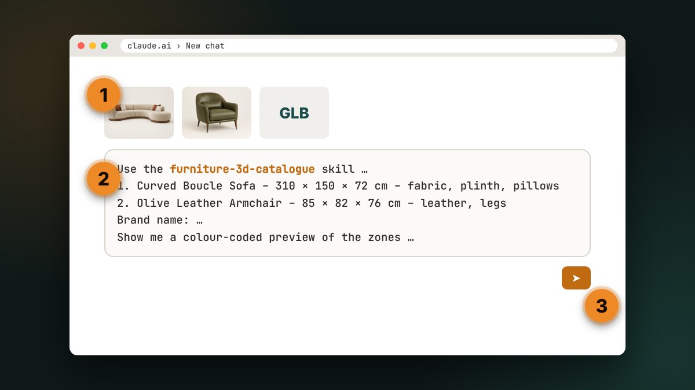
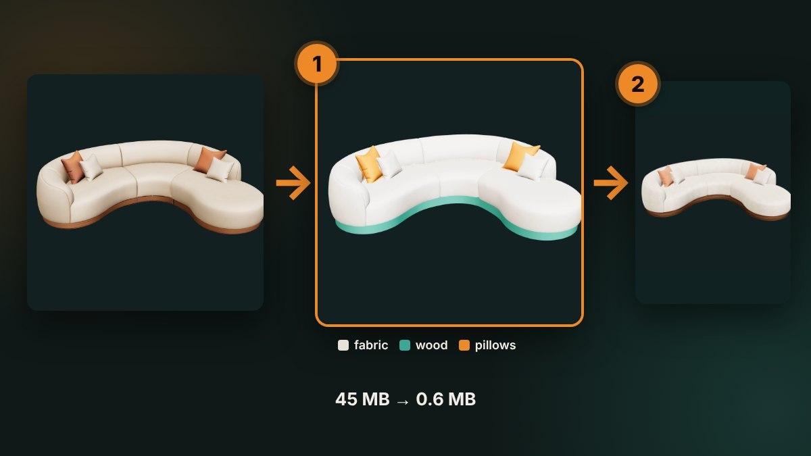
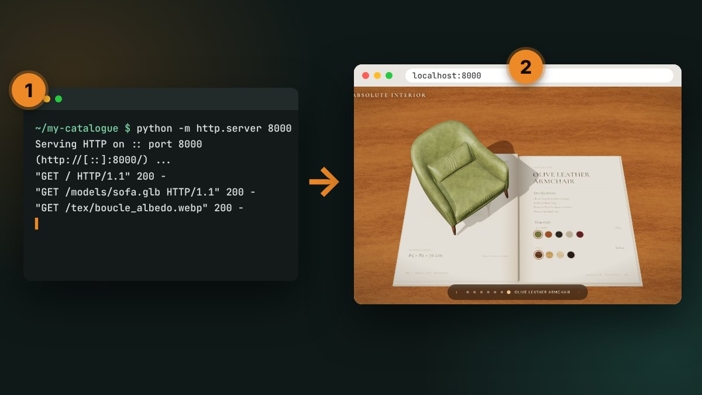
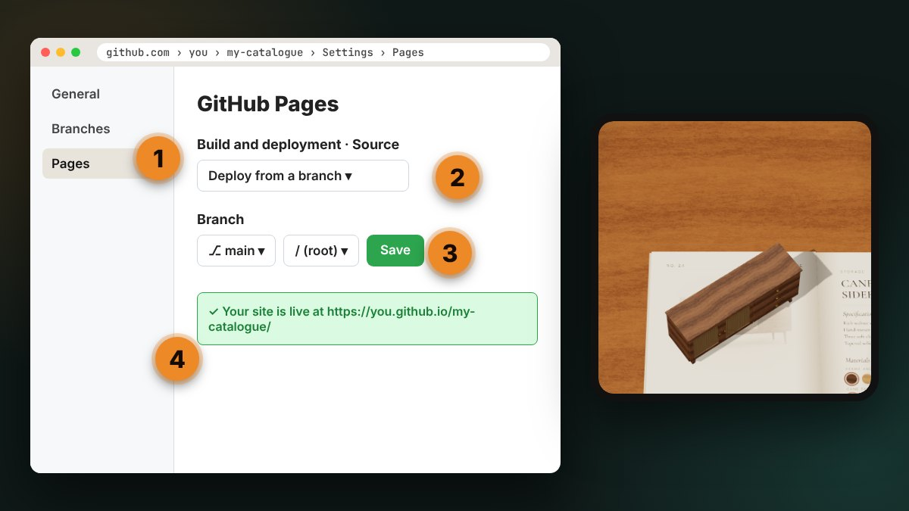

<p align="right"><b>English</b> · <a href="STEP_BY_STEP.ar.md">العربية</a></p>

# Step by step: make your own 3D furniture catalogue with Claude

From product photos to a live 3D catalogue link you can send to clients. No coding needed. About 30–60 minutes for a few pieces.

**What you'll end up with:** a web page like the [live demo](https://ahmakader.github.io/absolute-interior-3d-catalogue/). It's an open book, each piece rises out of its page, the client can turn it any way, and tapping a swatch changes the fabric, leather, wood or stone on the piece.

---

## What you need

| | |
|---|---|
| ✅ **Claude** | Any plan that has Skills (Free, Pro, Max, Team or Enterprise), with code execution turned on. |
| ✅ **Your product photos** | One clean photo per piece. |
| ✅ **A 3D model per piece** | Made from your photo with an image-to-3D tool, or downloaded. See step 3. **This repo does not turn photos into 3D by itself.** |
| ⭕ **A GitHub account** | Optional and free. Only needed if you want a public link for your catalogue. |

---

## Step 1: Look at the demo

<p align="center"></p>

**①** the piece rises out of the page · **②** tap a swatch to change the material · **③** page dots and arrows to turn pages. Right: the same catalogue on a phone.

Open the [live demo](https://ahmakader.github.io/absolute-interior-3d-catalogue/) and scroll through it. Drag a piece to turn it and tap the swatches. This is exactly what you're going to build.

## Step 2: Prepare your photos

<p align="center"></p>

**①** good: the whole piece, plain light background, three-quarter angle · **②** bad: piece cut off, or a dark photo with heavy shadows · **③** for each piece, note the real size, the parts that can change and the options.

- **One photo per piece**, with the whole piece in frame.
- **Plain, light background.** A studio or catalogue shot is ideal.
- **Three-quarter angle** (front and one side visible). Straight-on photos make flat-looking models.
- No people, no other furniture overlapping, no heavy shadows.
- For each piece, write down:
  - **name**, for example "Curved Boucle Sofa"
  - **real size** in cm, width × depth × height
  - **the parts the client can change**, for example *fabric · legs* or *top · base*
  - **the options** for each part, for example *5 boucle colours · walnut / oak / black legs*

## Step 3: Get a 3D model for each piece

<p align="center"></p>

**A** your product photo → **B** the raw model from an image-to-3D tool (heavy, about 45 MB, all one material) → **C** download it as a `.glb` file. Below: tools and libraries you can use.

Choose one route:

**A. Let Claude make them (easiest).** Connect an image-to-3D tool to Claude, for example the **Higgsfield** connector (it runs Hunyuan3D). Then Claude can create the 3D models from your photos itself. This uses that service's credits.

**B. Make them yourself online, then upload them.** Upload each photo to an image-to-3D website and download the result as **GLB**:
- [Meshy](https://www.meshy.ai) (free tier)
- [Tripo](https://www.tripo3d.ai) (free tier)
- [Hunyuan3D](https://3d.hunyuan.tencent.com)
- [Rodin](https://hyper3d.ai) (paid, highest detail)

Name each file after the piece, for example `sofa.glb`.

**C. Download ready-made models.** If you sell real brand furniture, the manufacturer often has free models on [BIMobject](https://www.bimobject.com). For free models there's [Poly Haven](https://polyhaven.com/models), or [Sketchfab](https://sketchfab.com/search?features=downloadable&type=models&q=furniture) (check each licence).

> The models from routes A and B come out heavy, messy and all one material. That's normal. Cleaning them up is the skill's job.

## Step 4: Add the skill to Claude

<p align="center"></p>

**①** download the ZIP · **②** Customize → Skills · **③** click **+** · **④** Upload a skill · **⑤** make sure it's switched on. *Diagram: Claude's screens may look slightly different.*

1. Download **[`skill/furniture-3d-catalogue.zip`](../skill/furniture-3d-catalogue.zip)** from this repo (open the file, then click **Download raw file**).
2. In Claude, turn on code execution: **Settings → Capabilities → "Code execution and file creation"** (in newer layouts it's called **"Create and edit files"**). On Team or Enterprise, an owner enables it.
3. Go to **Customize → Skills**, click **+**, then **+ Create skill → Upload a skill**, and choose the ZIP.
4. Make sure **furniture-3d-catalogue** is toggled **on**.

*Using Claude Code instead?* Copy the folder `skill/furniture-3d-catalogue` to `~/.claude/skills/`.

Menu names can change. If yours look different, see Anthropic's guide: [Use Skills in Claude](https://support.claude.com/en/articles/12512180-use-skills).

## Step 5: Ask Claude to build it

<p align="center"></p>

**①** attach your photos (and GLB files) · **②** paste the prompt and fill in your pieces · **③** send.

Start a new chat, attach your photos (and your GLB files if you chose route B or C), and paste:

```text
Use the furniture-3d-catalogue skill to build a 3D catalogue from these products.

1. [Name] – [W × D × H cm] – changeable parts: [e.g. fabric (5 boucle colours), legs (walnut, oak, black)]
2. [Name] – [W × D × H cm] – changeable parts: [...]
3. ...

Brand name for the cover: [your brand]
3D models: [generate them from the photos with the connected tool / use the GLB files I attached]
Show me a colour-coded preview of the material zones for each piece before you build the book.
```

## Step 6: Check the zones, then let Claude finish

<p align="center"></p>

**①** the colour preview Claude shows you: each colour is one material zone (fabric / wood / pillows). Check it. · **②** the finished piece with real materials, shrunk from 45 MB to 0.6 MB.

Claude will:
1. turn each photo into a 3D model (route A), or take your GLB files
2. **split each model into material zones**, for example fabric / wood / pillows, and show you a colour preview
3. clean the mesh and shrink it to under 1 MB
4. add real materials (fabric, leather, wood, stone) at true scale
5. build the book with your pieces, then test every page and swatch

👉 **When you see the colour previews, check them.** If a zone is wrong, say so in plain words, for example *"the pillows should be a separate zone"* or *"the legs are mixed with the frame"*. Claude fixes it before going on.

At the end you get a **ZIP of your catalogue folder**.

## Step 7: Open it on your computer

<p align="center"></p>

**①** start the server inside your catalogue folder · **②** open `localhost:8000` in your browser.

Unzip it. Double-clicking `index.html` **won't work**, because the browser blocks loading 3D files straight from your disk. Instead:

- **Windows / Mac / Linux with Python:** open a terminal in the folder and run `python -m http.server 8000`, then go to http://localhost:8000
- **Or with Node:** `npx serve .`
- **Or VS Code:** install the "Live Server" extension and click **Go Live**.

## Step 8: Publish it and share the link (free)

<p align="center"></p>

**①** Settings → Pages · **②** Deploy from a branch · **③** `main`, `/ (root)`, **Save** · **④** after 1–2 minutes your link appears. It works on phones too. *Diagram: GitHub's page may look slightly different.*

1. Create a free account on [github.com](https://github.com) and click **New repository**. Give it a name, make it **Public**, and create it.
2. On the empty repo page, click **uploading an existing file** (or **Add file → Upload files**). Drag in **everything inside** your catalogue folder (`index.html`, `models`, `tex`, `img`…) and click **Commit changes**.
3. Go to **Settings → Pages**. Under *Build and deployment*, choose **Deploy from a branch → main → / (root)** and click **Save**.
4. Wait 1–2 minutes and refresh. Your link appears at the top: `https://<your-username>.github.io/<repo-name>/`

Send that link to clients. It works on phones too.

---

## Troubleshooting

| Problem | Fix |
|---|---|
| Blank page or "loading" forever | You opened `index.html` directly. Use a local server (step 7) or the GitHub Pages link. |
| A material looks speckled or fuzzy | A normal map was saved as WebP. Ask Claude: *"re-save all normal maps as JPEG 4:4:4"*. |
| The wrong part changes colour | The zones are mixed. Ask Claude to redo the zones for that piece and show the colour preview. |
| The piece is the wrong size | Give Claude the real dimensions again and ask it to rescale. |
| The back of the piece looks odd | Image-to-3D tools guess the hidden sides. Add a second photo from behind, or use a manufacturer model. |
| The GitHub link shows 404 | Pages needs 1–2 minutes. Check that `index.html` is at the top level of the repo, not inside a folder. |
| Claude says no 3D tool is available | Use route B or C in step 3 and attach the GLB files. |

## Change it later

- **Add a piece:** send Claude the new photo or model and *"add this to my catalogue"*, along with your current ZIP.
- **Change colours or options:** everything is in the `PIECES` list at the top of `index.html`. Claude can edit it for you.
- **Use real materials:** send scans or photos of the manufacturer's fabrics and ask Claude to make texture sets from them.

---

Questions or ideas? Open an issue on this repo.
